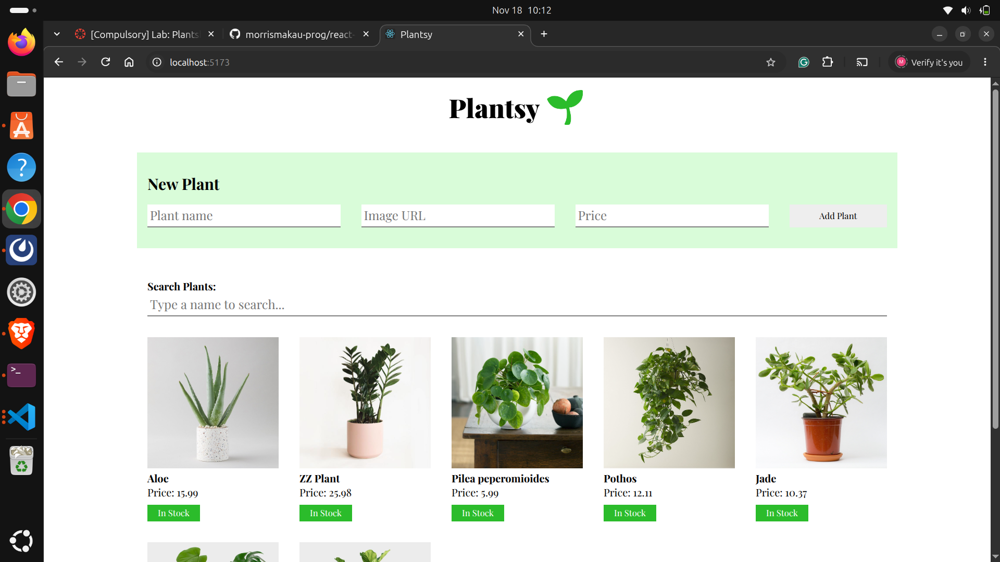

# Plantsy

Plantsy is a React e-commerce storefront application that allows store administrators to view inventory, add new plants to the catalog, mark items as out of stock, and search plants in real time.

## Visuals



## Installation

1. Clone the repository and navigate to the project folder.
2. Install dependencies:
   ```bash
   npm install
   ```

## Usage

1. Start the JSON server backend (runs on port `6001`):
   ```bash
   npm run server
   ```
2. In a separate terminal, start the Vite development server:
   ```bash
   npm run dev
   ```
3. Run the test suite:
   ```bash
   npm test
   ```

## Features

- **View Catalog:** Fetches and displays all plants from the backend on initial page load.
- **Add Plants:** Submits new plant details via a controlled form and persists them with a `POST` request.
- **Stock Management:** Toggles plant availability between "In Stock" and "Out of Stock".
- **Live Search:** Filters displayed plants dynamically as the user types.

## License

[MIT](https://choosealicense.com)
